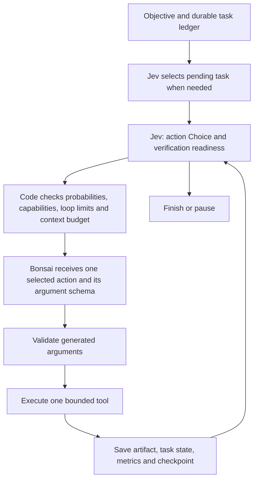

# Leana

A small TypeScript coding harness that uses **Jev for action selection and context relevance** and **local Bonsai for code, task descriptions, and tool arguments**. Node 22+, ripgrep, zero runtime npm dependencies.

This is a working prototype, with explicit limits and inspectable traces. Its advantage on long refactors still needs measurement against Cline on the same repository and tasks.

## Run

Install ripgrep if `rg --version` does not work in your terminal. On openSUSE, run `sudo zypper install ripgrep`. Codex's bundled copy may be available inside Codex while absent from your normal terminal's `PATH`.

```bash
npm ci
npm run build

# Test both real endpoints. Key file can contain a raw key or TYPESAFE_API_KEY=...
node dist/src/cli.js doctor --key-file ~/.config/typesafe.key

# Read-only investigation
node dist/src/cli.js run "Find the cause of the failing parser test" \
  --repo /path/to/repository --key-file ~/.config/typesafe.key

# Edits and tests, explicitly enabled
node dist/src/cli.js run "Fix the failing parser test with a focused change and verify it" \
  --check "npm test" \
  --repo /path/to/repository --key-file ~/.config/typesafe.key \
  --allow-write --allow-bash

# Resume the exact session path printed by run; capabilities must be enabled again
node dist/src/cli.js resume /path/to/repository/.leana/runs/SESSION \
  --key-file ~/.config/typesafe.key --allow-write --allow-bash \
  --message "Continue; the intended behavior is ..."
```

Alternatively, supply `TYPESAFE_API_KEY` in the environment or `--env-file PATH`. The optional `LOCAL_API_KEY` defaults to `local`. The key is neither copied into the project nor written to event logs. `--key-file` takes precedence over the environment. `npm link` is optional if you want a global `leana` command.

Defaults match the supplied server: `http://127.0.0.1:8080/v1`, model `bonsai-27b`, 48,000 total context tokens, 4,096 maximum output tokens, and reasoning disabled with `chat_template_kwargs.enable_thinking=false`. Configure with `--config leana.example.json`.

## Control flow



Jev selects among `read_files`, `search_codebase`, `write`, `replace_lines`, `move_lines`, `bash`, `tasks`, `finish`, and `ask_user`. The harness also applies the fixes it has resolved from a failing check itself (import lines inserted after the file's import block, `export` prepended at the declaration lines the check named), one attempt per fix set, and reads the lines a failing check names in the edited files before the worker is asked, so the worker only produces edits for what remains. Evidence is append-only: superseded or outdated entries are flagged in the prompt tail and evicted first, never rewritten in place, so the server's prompt-prefix cache holds across steps; there are no compaction votes. A new verification retires earlier verification results, and subsequent edits or verification retire old generation errors, so historical failures cannot crowd every successful result out of context. Up to 20 successful edits are retained separately as `editEvidence`, with bounded applied arguments and tool-result summaries; rollback removes the rejected edits. Loading a legacy checkpoint recovers this record from successful action/result pairs and their artifacts, excluding rolled-back edits. Referenced plan excerpts are retained separately from ordinary evidence and supplied to both models. When the objective names a numbered step and substep, the observed section heading and requested item stay visible without adjacent tasks expanding the scope. Before generating a final summary, the harness reads changed and inspected source files and extracts bounded source facts for identifiers named in the objective and referenced requirements. TypeScript and JavaScript imports, exports, and declarations come from the parser, so comments or strings cannot masquerade as code. These current facts establish final structure even when older rollback metadata or eviction removed the original edit record. Checks record hashes of changed files; completion rechecks those hashes after summary generation and reruns verification if they differ. A legacy paused session without these check hashes re-verifies once on resume. Jev routes on a small structured state (check summary, resolved fixes, rejected edits, recent evidence excerpts) that never exceeds its budget. Edits are transactions judged by the next check, and the harness owns that cycle: after every successful edit the last check command is re-run automatically before any model is consulted; a check that is worse for the files the transaction touched (any rise in their error count, or new syntax errors without a net decrease; errors the check does not attribute to a file always count; a `move_lines` transaction is judged on syntax only) rolls the transaction back with no vote, removing any file the transaction created; anything else is committed. An edit that would paste a block of five or more consecutive lines the file already contains, or an import or export line it already has, is refused. The verdict weighs unresolved names and modules first (`Cannot find name`, `has no exported member`, `Could not find a declaration file`): an edit that adds one is rolled back, one that removes one is kept even when the types it brings in surface further errors, and only when that class is unchanged does the plain count decide.

`move_lines` is an extraction, not a paste: the harness exports the moved top-level declarations, copies the source's import lines that the moved code uses into the destination with re-based paths, and inserts into the source the import it still needs from the destination. Names the moved code uses that the source declares without export are named in the result and reported by the check; the resolver then offers the export line in the source. The harness applies resolved import and export fixes only to files the session edited, never to a third file, and never re-applies a fix that was rolled back. A name declared in several files, or only in test files, is reported as ambiguous rather than guessed.

**Deliverable ledger.** At the start of a run the harness reads the documents the objective names, has the worker list the deliverables under a schema (typed items: move, create, modify, delete, export, import, verify), and asks Jev to classify each against the objective within its requested scope, plus whether the list is complete. Only items Jev judges required are kept. From then on each item's status is derived from source facts (a move is done when the destination declares the name and the source no longer does), items of kind move are performed by the harness one per step and judged by the check like any other forced edit, and the ledger is pinned for Jev and the worker. Set `"ledger": false` in the config to disable it.

**Completion on the diff.** A `finish` proposal, the worker's or the harness's, is judged on a structural diff of the changed files against the pre-edit snapshots: declarations added, removed and moved per file, imports added and removed, and the raw hunks, chunked by file when they exceed Jev's budget. Jev classifies, per ledger item, whether the diff implements it, whether the objective as a whole is met, and whether the diff contains out-of-scope changes. An item whose status is done by source facts counts as implemented. The summary text is recorded for the reader and never audited.

The check must be deterministic. A `tsc` run with `incremental: true` reuses a file's cached diagnostics until that file itself changes, so a new module that stops declaring globals leaves stale results for every other file; the harness warns at the start of a run and `doctor` reports it. Use `tsc --noEmit --incremental false` (or a script that does) as the check. After several inspections, routing asks for specific missing ranges or declarations; read and search remain available because an inspection count does not prove the necessary source was found. Duplicate-action and repeated-result guards still prevent loops. Each check is summarized (errors, syntax errors, per-file lines) and kept alongside the previous one; the rollback decision is deterministic, restores the edited files from the snapshots taken before them, and asks no model. The resolved import and export fixes below are applied by the harness itself, one file per step, each judged by its own check. The failing check's file and line locations are pinned as `focus` for both models, and every name the check cannot find is resolved from the repository to a ready import line (from where the other edited file imports it, or from its declaration, noting when that declaration still needs an export) and pinned as `missingNames`; locating those by search is exactly the work a small model spends dozens of steps on. Unresolved-name errors of every kind are covered: cannot find name, declared locally but not exported, and no exported member. Any edit that would leave a TypeScript or JavaScript file unparseable is refused before it lands, with the parser's line and message, using the harness's own TypeScript; that is far cheaper than a lint, a rollback and a rejected edit. Line-addressed edits (`replace_lines`, `move_lines`) are accepted only when the file has been read since it last changed, so line numbers always come from the current version; `lastCheck.staleFor` names files edited since the last check. Every edit first saves the file's previous content as an artifact named after the step and path, so a bad edit can be undone by reading that artifact. `replace_lines` rewrites, deletes or prefixes (`prepend`, for example `export `) up to 40 line ranges in one step, addressed by line numbers and applied bottom-up so they never shift each other, so only the new text is generated; an anchor-based `write` must echo the old text too, which for a long region exceeds the output budget and fails on any anchor mismatch. `move_lines` cuts a line range from a read file and appends it to another file without the text passing through the model, so a large block can be extracted into a new module by supplying line numbers from a search; a range whose brackets do not balance is refused with the line to read next, because a cut through a declaration breaks both files. When routing probability is spread too thinly to pass `routeProbability`, Jev is asked once more between the two leading candidates before the session pauses. The latest verification command's outcome is pinned as `lastCheck` in both prompts until the next check replaces it, so the errors that define the remaining work survive compaction. Disabled tools are removed from the offered choices. Routing is phase-scoped: `inspect` permits exact reads and searches, `implement` permits edits, diagnostics and checks, and `verify` permits checks before completion. `finish` requires a passing check after the last edit, or a passing check with no edits when the objective is already satisfied. `leana run` refuses to start over uncommitted files that an earlier session changed, naming that session to resume, unless `--allow-dirty` is passed. After three successful inspection actions, reads and searches stay available but are described as valid only when an edit needs source text not yet in evidence; removing them outright forced writes before the source file was read, and the worker then invented file content. When `finish` is selected, it proposes a summary for one authoritative completion audit. Jev checks each summary claim separately and checks coverage of the requested deliverables, using tool evidence and the changed-file record and excluding the worker-written task ledger. Every claim score must meet `completeProbability`, along with either deliverable coverage or recognition of an explicit user instruction to finish when the recorded check passes. The explicit stopping condition additionally requires successful edit evidence and a current passing check after the last edit; an untouched passing baseline cannot trigger it. A generic request to run tests does not imply this stopping condition. The audit uses at most eight claim questions plus coverage and the stopping-condition question, grouping any remaining sentences into the last claim rather than dropping them. Rejections name the unsupported claims so the worker can correct its report or gather the missing evidence. A rejected completion is recorded and the loop continues; a second rejection pauses the session. Bonsai sees only the selected action's schema and cannot override the routing by returning a different tool name. The adapter uses schema-constrained JSON arguments, so it does not depend on a model's native tool-call syntax. Any edit that would leave a file with more unmatched brackets than before is refused as a cut through a declaration. After three edits without a verification, edit routes are withheld until a check runs. A read or search repeated after the file changed counts as a new action, and search digest entries under an edited path are dropped. A failed edit whose target was stale or unread removes `write` until the file is re-read; other edit failures keep `write` available with the exact error so Bonsai can correct the replacement. In `verify`, a passing check re-offers `write` and `read_files` as a return to implementation, so an unfinished objective does not force another identical check. Routing does not ask a separate abstract completion question that can veto a finish vote and send the worker back into unrelated reads; completion is assessed against the concrete summary and retained tool evidence. A current failing check or a pending verification withholds `finish`, even when an earlier check passed. A rejected completion records persistent feedback and returns to implementation instead of pausing after two attempts. Another finish requires a successful source read, search, or edit; bookkeeping and repeated verification alone do not unlock it. Legacy completion pauses resume with the same recovery behavior. Completion thresholds and claim-support checks remain unchanged.

The session inventories repository files deterministically. Both models receive a relevance-ranked subset of that list (paths whose segments the objective, ledger or edits mention, at most 80), a directory overview with file counts, and `readCoverage`, the line ranges already read per file, which survives evidence eviction so a large file is not re-read from line 1. Sending the raw list of a thousand paths consumed a third of the working context and pushed evidence out after three reads. `read_files` rejects directories and wildcard paths locally, so a generated `test/*.test.mjs` argument becomes a clear tool error instead of a filesystem lookup. The last tool error, current phase, inspection count, and changed files are also included in the next decision state. `read_files` output is cut at line boundaries inside `toolChars` and reports the last line shown, so text used for exact replacements is never truncated mid-line. A successful write marks earlier reads of the same file as superseded. Every search's query and its first matches are pinned as `searched` in both prompts, so located symbols stay known after eviction and remaining ones are visible. Two consecutive generation failures on a route remove that route from routing until an action of another route succeeds, instead of pausing; four in a row pause. When edits are withheld until a verification runs and Jev routes to `bash`, the harness re-runs the last check command itself rather than asking the worker for one. Jev's state shrinks in stages (previews, then optional lists, then the evidence tail) to stay under 22 KB. A search whose query is already in the digest counts as executed even after its entry was evicted. Generated arguments identical to an action already executed in the session, whose result is still in evidence, are not run: the repeat is recorded as a generation failure with the earlier result named, and Jev routes again. The second time an action type produces an identical result, whatever its arguments, a warning is recorded in the decision state; a third withholds that route until another action succeeds; a fifth pauses the session.

When a task ledger is useful, Jev selects `tasks`, Bonsai generates or updates at most twelve items, and Jev selects the next pending item. The active task stays pinned until it is completed. Task descriptions are generation; choosing which task to work on is a decision. Existing task IDs cannot disappear from an updated ledger.

Routing requires both a minimum selected-option probability and a minimum margin over the runner-up. `confidence` is logged separately: it describes the distribution, and is not treated as a probability of correctness. The initial thresholds are engineering defaults, **not calibrated accuracy guarantees**. Ambiguous routes and provider failures pause instead of silently switching decision-making back to Bonsai.

The sampling schema omits string length ceilings over 1,000 characters to avoid a [llama.cpp GBNF repetition-bound bug](https://github.com/ggml-org/llama.cpp/issues/27087), reproduced on the local server with `maxLength: 2000`. The original schema remains in the prompt and all limits are enforced by local validation before any tool executes.

## Context without recursive summaries

Every generation gets a rebuilt working set rather than an ever-growing conversation. The root objective, root `AGENTS.md`, and bounded task ledger remain pinned. At most twenty evidence entries remain active, each limited to 6,000 characters by default. Truncation is explicit and includes a pointer to the stored tool artifact. The system prompt remains stable to allow llama-server prefix reuse where possible.

Jev receives a separate decision packet capped at 22 KB of UTF-8 data: objective, ledger, evidence previews, recent evidence, and change/check metadata. As this packet fills, previews shrink; pinned task information is not silently discarded. The complete Jev request is capped at 50 KB. These byte caps conservatively keep requests below Jev's documented token limits; they are not a substitute for semantic relevance.

Jev relevance questions are batched with routing when there are at least eight active entries and the compaction cooldown permits it. A semantic compaction keeps roughly 60% of entries, favoring relevant evidence and preserving the latest two. A four-step cooldown prevents repeated soft compaction, and relevance questions are only asked once the previous prompt reached 70% of `workingTokens`; compacting a small prompt discarded tool errors that still carried the next step. The current sha256 of every file read or edited is pinned in the worker prompt as `fileHashes`, so `expectedHash` does not depend on evidence surviving. Compaction never calls Bonsai to summarize a summary.

Before inference, the harness calls llama-server `/apply-template` and `/tokenize` to count the actual rendered prompt. The default active working limit is **12,000 tokens**, independently of the **48,000-token context ceiling**. Old evidence is evicted until the prompt fits; 4,096 output tokens and 1,024 safety tokens are reserved. If tokenization endpoints are unavailable, UTF-8 byte length is used as a conservative bound for byte-level tokenizers. The harness refuses inference when pinned material cannot fit. This fallback is intended for compatible text models, not arbitrary tokenizers or unknown server-side prompt injection.

Full retained outputs live outside the prompt. Use `read_files` with `@artifact/00001.txt` to recover one, or `search_codebase` with `path: "@artifacts"` to search archived evidence. This allows recovery after eviction. A command that exceeds the output cap is killed, so artifacts do not contain output the command never produced or output discarded at the cap.

## Tools and execution boundaries

| Action | Behavior |
| --- | --- |
| `read_files` | Up to three files, 250 lines and 20,000 returned characters each, 1 MiB per source file (8 MiB for artifacts). Returns line numbers and full-file SHA-256. Invalid UTF-8 is rejected. |
| `search_codebase` | Literal ripgrep search or file listing; respects normal ignore rules, excludes common secrets and session directories. |
| `write` | One unique exact text replacement with a matching SHA-256, or exclusive creation of a new file. Existing edits use a temporary file and rename. |
| `bash` | One foreground command with timeout, bounded combined output and process-group cleanup. |
| `tasks` | Persistent structured work ledger, up to twelve tasks, with evidence required for completed entries. |
| `finish` | Available when no tasks remain pending and a successful shell command follows any tracked write. The proposal is audited on the repository's structural diff against the deliverable ledger, never on the summary text. |
| `ask_user` | Persists the session and returns the question to the terminal. Resume with `--message`. |

Writes and shell are disabled by default. Filesystem tools reject absolute paths, traversal, and symlink targets outside the repository, along with `.git`, `.leana`, `.env*`, private-key filenames, and dependency folders. These checks are useful boundaries for cooperative local use, **not an OS sandbox or a defense against concurrent hostile filesystem races**.

`--allow-bash` permits arbitrary shell commands with the current user's privileges, including writes outside the repository even without `--allow-write`. Use a container/worktree appropriate to the repository's trust level. The child process receives a small environment allowlist rather than inheriting API keys. If a build requires other environment variables, the current prototype needs explicit adaptation. Permission decisions never come from a Jev probability.

Jev is hosted: the objective, task text, and bounded source/output excerpts are sent to TypeSafe. Bonsai inference uses the configured local endpoint. Local session artifacts and action logs can contain source code and command arguments. Secret filename exclusions are a convenience, not general secret detection.

## Sessions and measurements

Each run creates `.leana/runs/<timestamp-id>/`:

- `checkpoint.json`: pinned state, task ledger, active evidence, counters, status.
- `events.jsonl`: Jev requests (exact state and questions), answers/distributions/model/usage/latency, provider errors, Bonsai usage/latency, selected actions, compactions and results. Request IDs pair requests with responses or errors.
- `leana doctor` also measures prefix-cache reuse with a prompt of eight user messages, changing the sixth. Hybrid and sliding-window models (the Bonsai 2 family is `qwen35`) can only resume from saved checkpoints, and llama-server creates mid-prompt checkpoints only at the start of a user message, spaced at least `--checkpoint-min-step` tokens apart (default 8192). The worker prompt is therefore sent as one user message per pinned block and per evidence entry, oldest first, with the volatile fields last; run llama-server with `--checkpoint-min-step 0 --ctx-checkpoints 128` so every boundary gets a checkpoint, and a step then reprocesses only what changed.
- Prompt size is bounded independently of `workingTokens`: at most 12 evidence entries (reads keep up to `toolChars`, command output 2.5 KB, searches 1.5 KB, other results 600 bytes; a superseded read collapses to its header line and a re-read replaces the older copy of the same range), and the volatile tail after the evidence (check summary, focus, resolved names, rejected edits, search digest) is held to a few KB. That tail is reprocessed by the server on every step, so its size, not the budget, sets the per-step cost. A larger `workingTokens` only lets more evidence survive; 16k to 20k is the useful range for this model.
- `report.html`: written by `leana report SESSION [--follow]`. A self-contained page with, per step, the Jev questions, criteria, probabilities, latency and supplied state; the exact worker prompt with a per-section breakdown of the context it occupies and its share of the working budget and context window; the generation's latency, generated tokens, tokens per second, prompt-processing speed and cached tokens (from llama.cpp timings); the generated arguments; and the tool result. Charts show context use and generation speed across the run. `--follow` regenerates it while a run is live. `--verbose` on `run` or `resume` streams the same facts to stderr as each phase completes.
- `artifacts/NNNNN-prompt.json`: the exact messages sent to Bonsai at step NNNNN (a `-2` suffix marks the retry after a repeated action); `NNNNN-<path>` files are pre-edit snapshots.
- `jev-decisions.md`: readable Jev questions, choice descriptions, supplied state, answers, probabilities, confidence, timing and errors. Each request identifies the runner step and decision phase. Requests are logged before the API call, including when the call fails. No API headers or keys are logged; the supplied state can contain repository content.
- `artifacts/`: retained tool outputs retrievable without replaying commands.

Checkpoints are replaced atomically. A repository lock prevents two Leana invocations from editing the same repository concurrently. An intent note is saved before actions; recovery exposes possible interrupted effects instead of automatically replaying the action. If the process was killed, check for a running process before removing `.leana/run.lock`.

Each invocation has a step limit (`--max-steps`, default 80). Three identical action/result pairs pause the session. Two consecutive generation failures also pause. HTTP rate limits and transient Jev server failures have bounded backoff; authentication failures stop. Mutating tools are never retried automatically.

Exit codes: `0` completed or successful doctor check; `2` a persisted pause; `1` setup/CLI failure.

## Verification and remaining work

### Multi-file refactor benchmark

```bash
npm run bench:refactor -- --key-file ~/jumanji.txt
```

This uses the live providers on a reproducible order-processing refactor. It checks exact behavior against the original implementation, verifies that three adapters actually use the extracted shared layers, and produces diffs, timing/token/context metrics, and readable Jev questions. For repeated trials, add `--runs 3`.

The [benchmark guide](BENCHMARK.md) describes the task, independent checks, reports, and how to prepare the identical fixture for Cline comparison. A separate `prepare` command creates a fixture without calling either API.

### Repeatable live coding test

With llama-server running and ripgrep installed:

```bash
npm run test:live -- --key-file ~/jumanji.txt
```

This builds Leana and calls **real Jev and Bonsai**. It creates a fresh disposable cart project in `work/live-tests/cart-*/repo`, demonstrates failing tests, and asks the agent to fix quantity handling in `src/cart.mjs`. It enables writes and shell execution for the run. The shell retains the normal harness permissions described above; the fixture directory is not an OS sandbox.

After the agent exits, a separate verifier is created outside its repository. It checks five named cases plus sixty additional input combinations and confirms the original tests were not modified. A `PASS` requires independent verification, actual Jev and Bonsai calls, and successful agent completion. A pause counts as a failed run even if the implementation happens to be correct.

The terminal prints a unified before/after file diff (`-` removed lines, `+` added lines), followed by the result. The diff includes modified, added, and deleted fixture files; `.leana`, `.git`, and `node_modules` are excluded. It also prints paths to `changes.diff`, `result.json`, `verification.txt`, and the agent session. `before.json` and `after.json` preserve file snapshots, and `baseline.txt` records the initial failing tests. Every invocation uses a new directory, so it cannot inherit a previous fix. The fixtures and logs are retained for inspection.

Optional flags: `--config PATH`, `--env-file PATH`, `--max-steps N` (default 16). `TYPESAFE_API_KEY` in the environment works instead of `--key-file`.

To prepare a fixture and demonstrate its failures **without calling either API**:

```bash
npm run test:live -- --prepare-only
```

### Automated tests

```bash
npm test
npm run check
```

`npm test` remains offline. It also checks that the live fixture's verifier rejects the original bug and altered tests, and accepts the correct implementation; these checks do not invoke either model.

Tests cover API wire format and response validation, uncertain routing, retries, context limits and cooldown, task persistence, traversal and symlink boundaries, stale edits, command caps, archived reads, and orchestration through completion. `doctor` exercises both configured providers with synthetic content.

This first version loads the repository-root `AGENTS.md`; nested instruction discovery is not yet implemented. There is no automatic Git rollback, parallel worker pool, interactive TUI, vector database, MCP layer, or background daemon. File paths and string replacements are generated by Bonsai. Long function rewrites must be split into edits that fit the 4,096-token generation limit.

Completion remains an evidence judgment: a zero-exit shell command is a prerequisite after tracked writes, not proof of correctness. Task evidence is model-written; Jev reviews tool evidence before finishing. Arbitrary bash mutations cannot be tracked as precisely as `write` actions. Review diffs and the actual verification command when evaluating results.

The included refactor benchmark is a step toward a reproducible long-refactor suite. Its synthetic fixture does not establish performance on large production repositories. Compare repeated verified completion rates with identical model/server settings and no competing inference requests. Cline comparison is supported through an identical prepared fixture and shared verifier, but no Cline result is fabricated or inferred from Leana's traces.

## References

- [TypeSafe HTTP API](https://docs.typesafe.ai/api): request and response contract.
- [Choice](https://docs.typesafe.ai/primitives/choice), [Noul](https://docs.typesafe.ai/primitives/noul), and [confidence](https://docs.typesafe.ai/confidence).
- [Jev models and request limits](https://docs.typesafe.ai/models).
- [Jev 1.13 limitations](https://docs.typesafe.ai/model-jaggedness/jev-1.13): small states, arithmetic in code, and generation delegated to a generative model.
- [llama-server API](https://github.com/ggml-org/llama.cpp/blob/master/tools/server/README.md): chat generation, schema constraints, templates and tokenization.
