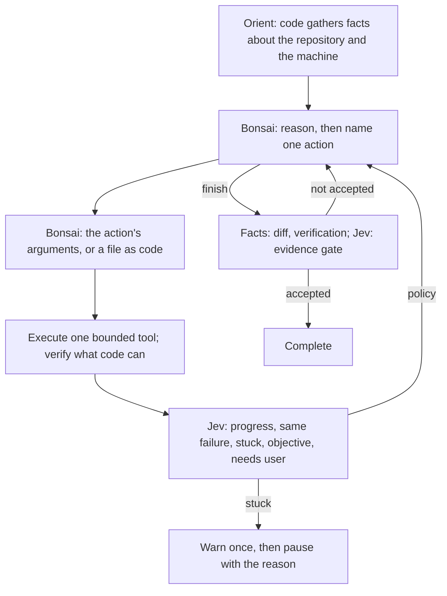

# Leana

A small TypeScript coding agent: **local Bonsai reasons and acts** through tools, one step at a time, and **Jev is the control plane around the loop**: it watches for progress, triages failures, ranks retrieval and gates completion claims, and never decides how to implement anything. Node 22+, ripgrep, zero runtime npm dependencies.

This is a working prototype, with explicit limits and inspectable traces. Its advantage on long refactors still needs measurement against Cline on the same repository and tasks.

## Run

Install ripgrep if `rg --version` does not work in your terminal. On openSUSE, run `sudo zypper install ripgrep`. Codex's bundled copy may be available inside Codex while absent from your normal terminal's `PATH`.

On Windows, install [Git for Windows](https://git-scm.com/download/win) as well (`winget install Git.Git`): commands run with its bash, which Leana finds from the `git` on your `PATH` or its default install location, without needing bash on the `PATH` (set `LEANA_BASH` to use another). The worker is told it is on Windows with Git Bash. Python projects get their venv in `.venv/Scripts`. Since Windows has no process groups, each command's shell carries a mark in its environment (`LEANA_RUN`), and what a command leaves running is found by that mark and stopped, as on Linux. That lookup adds about a quarter of a second to every shell step.

```bash
npm ci
npm run build

# Test both real endpoints. Key file can contain a raw key or TYPESAFE_API_KEY=...
node dist/src/cli.js doctor --key-file ~/.config/typesafe.key

# Read-only investigation
node dist/src/cli.js run "Find the cause of the failing parser test" \
  --repo /path/to/repository --key-file ~/.config/typesafe.key

# Edits and tests (write and shell are on by default; --no-bash or --read-only turns them off)
node dist/src/cli.js run "Fix the failing parser test with a focused change and verify it" \
  --check "npm test" \
  --repo /path/to/repository --key-file ~/.config/typesafe.key

# Resume the exact session path printed by run
node dist/src/cli.js resume /path/to/repository/.leana/runs/SESSION \
  --key-file ~/.config/typesafe.key \
  --message "Continue; the intended behavior is ..."
```

Alternatively, supply `TYPESAFE_API_KEY` in the environment or `--env-file PATH`. The optional `LOCAL_API_KEY` defaults to `local`. The key is neither copied into the project nor written to event logs. `--key-file` takes precedence over the environment. `npm link` is optional if you want a global `leana` command.

Defaults match the supplied server: `http://127.0.0.1:8080/v1`, model `bonsai-27b`, 48,000 total context tokens, 4,096 maximum output tokens, and reasoning disabled with `chat_template_kwargs.enable_thinking=false`. Configure with `--config leana.example.json`.

## Control flow



There is no design phase and no task ledger written by the harness. The loop is the one every working coding agent runs: orient, reason, act, observe.

**Orient by code.** Before the first step the harness gathers what a developer would look at: the tree and its directories, the manifests of every project (each ecosystem in each manifest directory, so a JavaScript frontend beside a Python backend is two projects), the toolchains present on the machine with their versions, what each ecosystem offers as a verification command, and what the manifest declares. No model call. The facts sit in the pinned block of every prompt for the whole run.

**Reason, then act, in batches.** Each turn the worker sees the objective, the orientation, its own running notes, the recent evidence and the check state, and in one generation writes a few sentences of reasoning followed by an ordered batch of one to eight actions with their arguments (a schema union over the actions, so the grammar holds each action's arguments to it). The harness runs the batch back to back, feeding each result, and stops at the first failure or refused action, which is when reasoning is worth paying for again; Jev reads the state once per batch. Files still generate one at a time, but the model does not speak between them: a twelve-file application is around twenty-five generations, not a hundred. The actions are `read_files`, `search_codebase`, `bash`, `create_file`, `write`, `replace_lines`, `move_lines`, `plan` (replace the notes), `finish` and `ask_user`. Whether to scaffold with the ecosystem's generator or author files, which packages to declare, which command is the check: the worker decides from what the tools return, and the package manager is the authority on versions. A file is generated as raw code (see the invariants), with the real exported signatures of the repository modules it names and the packages the manifest declares in front of the worker, so nothing is invented.

**Observe with facts added.** A check's result is its exit code and its output as the tool printed it, kept from both ends; no tool's format is parsed. The files its output names are attributed only when the path resolves to a file of the repository, with the line when one follows, and the source around those lines travels with the result. What a shell command changed is read from the tree (every file's size and modification time before and after the command, outside installed environments and what git ignores), never guessed from how the command starts: `cat > file <<EOF` is an edit like any other. A file a command left with the bytes it had (its modification time moved, its content hash and size did not) is not an edit and is said so, with the hash when the session has read or written the file; a file a command wrote is judged by its parser as after an edit. A written file that does not parse is said so at once by the language's own tool, with the line, the column the parser names and the text that starts there, and the line's text; a problem the text it replaced had too (the same message on the same line of the replaced text, unchanged but for indentation, wherever it moved) is said to be the same, so the text it names is text the write did not change; and a line edit that would leave a file unparseable by its in-process parser is refused before it lands, naming the lines the replaced ranges held that the new text drops (a file already broken is never blocked from a repair): TypeScript's for JS, TS and JSON, and for a component file (`.vue`, `.svelte`) the compiler its project installed, loaded from the project's `node_modules`, or, before one is installed (and for `.astro`), the balance of its top-level blocks; a created file that imports a name a repository module does not export, or a package the manifest does not declare, is told the fact and nothing is fixed for it. The command the worker marks as its check (`check: true`) is the check of record: a finish before it has run since the last edit is refused with that fact, a run is compared with the previous run of the same command as a fact (the exit code and the files named, before and after), and the worker decides when to run it, so several edits can be judged by one run. Nothing is rolled back: an edit that made the check worse is reported, and the worker sees the new errors and continues. Dependencies are installed per project whenever its manifest changes (a venv for Python, the environment's tools on the path of every command). The files the objective names are read by the harness and pinned in chunks; when they do not all fit, Jev ranks them against the objective, and a changed file is read and ranked again. Search results with many hits are ranked by Jev for the worker's stated purpose and the prompt carries the relevant few.

**One cached prefix.** The prompt is ordered by how often each part changes, because the server reuses its cache only up to the first changed message: the system message and the orientation (with the action catalogue) never change in a session, the evidence is append-only and evicted in batches, and the notes, file list, check state and request come last. A reasoning turn and a file generation share the same prefix, so neither re-processes the other's context. Through OpenRouter the same layout is cached by the provider: when a model's catalogue entry lists a cache-read price, the end of the orientation and the end of the evidence are marked with `cache_control`, the form OpenRouter takes for every provider (Anthropic, Gemini and Qwen read it; OpenAI's explicit mode gets it translated; providers that cache on their own ignore it), and a run's requests share one `session_id`, so they stay on the provider whose cache holds the prefix. A provider that refuses the markers is asked again without them, and the run goes on unmarked. `/set prompt-cache off` (config `promptCache`) turns both off. Cached tokens show in the generation line as the provider reports them. Dependencies are installed whenever a manifest appears or changes, once per version.

**See the result as its user meets it.** No build, type check or test shows what the user of the result experiences. The `observe` action does, through pluggable observers (`src/observe-catalog.ts` describes them, `src/observe.ts` implements them): `page` loads a page in the machine's headless Chromium over its debugging pipe; `http` starts a service and makes one request (status, content type, body, the keys of a JSON body); `program` runs the program from the shell as its user would (exit code, output). What an observation's `start` command starts runs for the length of that observation, beside the page, request or program, and is stopped with it; a shell step's processes are stopped when the step ends, and the processes it left running are named in its result. An observation with nothing to start at a local address where nothing accepts a connection is that fact, not a browser's error page. Each observer reports facts a text-only worker can act on and fails only on what is unambiguous (a page's exceptions and failed requests, a 4xx/5xx response, a non-zero exit); everything else is a fact for the worker and Jev to judge, such as how a page is styled (class names a selector matches and those none does, with the source files that use them). Each observer also owns the focused question the completion gate asks about its observations. The loop and the gate know only "an observation": whether one was made, whether it predates the last write, and whether it failed; a test keeps web vocabulary out of `agent.ts` and `control.ts`. Adding an observer means one catalog entry and one implementation. Consecutive turns that only read are a fact both the worker and Jev see.

**Jev as the control plane.** After each meaningful action Jev reads five probabilities over a small, literal state: progress since the previous reading, whether the latest failure is the same failure again, whether the worker is stuck, whether the objective is satisfied, whether the user is needed. The policies that act on them are deterministic: a repeated failure blocks the identical action; no progress for a run of steps with a high stuck reading first warns the worker, then pauses the session with the reason, so the step budget is never burnt in a loop. A failed command is triaged into a kind (code bug, wrong assumption, environment, dependency, permission, transient, ...): transient failures are retried once by code, permission failures go to the user, the rest are stated to the worker, whose repair it is. Jev also reads scope each step (is the latest work what the objective asks for), and three readings of work beyond the objective are named to the worker. When Jev reads the objective as satisfied and the check passed after the last edit, the harness proposes completion itself, once per check, so a worker that keeps polishing is not left to decide when to stop. A completion claim, the worker's or the harness's, is gated on facts code states (the diff, the verification after the last edit, the sources) and Jev's reading of their meaning (does the change implement the request, is any requirement unaddressed, and when the user wrote the objective as a list, is each item addressed, is the claim supported, how much verification the change deserves); a claim Jev routes to the user pauses the session for review. A finish with nothing written, checked or observed is an answer rather than a change: no check is asked for, and Jev judges it against what the worker read, shown the files and lines it read and the repository's files it never opened; when Jev reads part of the objective as unanswered, the rejection names those files. An answer has no check or observation left to settle it, so after three answers Jev does not accept in an invocation, the last goes to the user for review, whole, with Jev's readings; resuming with guidance continues the work. Every reading is logged, so a run is a telemetry stream of the same semantic state vector step by step.

### Invariants of the generation path

Generation is the whole cost: at 30 tokens a second a real file is a minute of generation and an application is a quarter of an hour of it with zero waste. Every rule in the loop that touches a generation follows from four invariants.

1. **Never spend a generation you will discard.** An action already taken on the same state, or one Jev found repeating a failure, is refused before it runs, with the reason in the evidence; one generation per step carries reasoning, action and arguments together. A repeated read or search has no side effect, so it stops nothing: the rest of its batch runs, the evidence states which entries show its answer for the file as it is now (hashed as read_files hashes it), and only lines no entry shows (a read the budget cut short) are read; a line longer than any read shows whole is stated with its length, never read again. A repeat of a read that failed is still refused with its error, a search runs again once a write or a check is recorded after it, and a turn of nothing but repeats (or of repeats and a failure) counts once toward the four in a row that end the attempt. Such a turn leaves the prompt and its statement stays (one per turn, so the record shows each time the request was made); the state is as it was, and a near-greedy sample of a prompt that has changed only by those statements returns the same turn (run 58: 196 identical tokens at steps 54 and 55). So after each turn that changed nothing (every action a repeat of a request already made: a repeated read or search, or a refusal of the same arguments on the same state; the notes as they were) the next step is sampled at the next temperature of `stepTemperatureEscalation` (0.5, 0.8, 1.0 by default, never below `stepTemperature`; `[]` turns it off). The first turn that changes something, and every new invocation (`resume`), return to `stepTemperature`; a refusal that states a new fact (a file that exists, a parse error) does not raise it, and a plan that leaves the notes as they were does not reset the four in a row, which bounds the streak. The server applies temperature after top_k, top_p and min_p, so a higher value reweights the same candidate tokens and never adds one; each `thought` event records the temperature it was sampled at.
2. **Validate before generating; tell the worker after; the repair is the worker's.** A written file is parsed, its imports checked against the repository and the manifest, and every fact goes back as evidence; the harness never rewrites a file from what a tool said.
3. **One tool, one meaning.** `create_file` creates, `rewrite_file` replaces a whole existing file, `write` replaces an anchor, `replace_lines` edits by line number, `move_lines` cuts lines and appends them unchanged to another file, `plan` replaces the notes. File content is never generated inside JSON arguments beyond a small edit: `create_file` and `rewrite_file` generate it as code, with the current content in front of the worker for a rewrite, and a turn cut off by the reply limit is told exactly that.
4. **Code is generated as code.** File content is a raw completion with the opening fence in the prompt and the closing fence as the stop word, continued by token ids so the model's cache holds.

**Profiles hold the narrow knowledge; the loop holds none.** Everything the harness knows about a particular ecosystem or language lives in `src/profiles.ts` as mechanics and fact providers: manifests and lockfiles, install commands (a Python venv, staged so nothing waits on code not yet written), what a failed install said, the verification candidates a repository offers, the words its commands start with, language-aware declarations, imports, signatures and syntax gates. A rule that maps a particular tool's particular complaint to a harness action is a defect wherever it sits: the harness delivers the fact and a route to act, and the model reasons.

## Context without recursive summaries

Every generation gets a rebuilt working set rather than an ever-growing conversation. The root objective, root `AGENTS.md`, and bounded task ledger remain pinned. At most twenty evidence entries remain active, each limited to 6,000 characters by default. Truncation is explicit and includes a pointer to the stored tool artifact. The system prompt remains stable to allow llama-server prefix reuse where possible.

Jev receives a separate decision packet capped at 22 KB of UTF-8 data: objective, ledger, evidence previews, recent evidence, and change/check metadata. As this packet fills, previews shrink; pinned task information is not silently discarded. The complete Jev request is capped at 50 KB. These byte caps conservatively keep requests below Jev's documented token limits; they are not a substitute for semantic relevance.

Jev relevance questions are batched with routing when there are at least eight active entries and the compaction cooldown permits it. A semantic compaction keeps roughly 60% of entries, favoring relevant evidence and preserving the latest two. A four-step cooldown prevents repeated soft compaction, and relevance questions are only asked once the previous prompt reached 70% of `workingTokens`; compacting a small prompt discarded tool errors that still carried the next step. The current sha256 of every file read or edited is pinned in the worker prompt as `fileHashes`, so `expectedHash` does not depend on evidence surviving. Compaction never calls Bonsai to summarize a summary.

Before inference, the harness calls llama-server `/apply-template` and `/tokenize` to count the actual rendered prompt. The default active working limit is **12,000 tokens**, independently of the **48,000-token context ceiling**. Old evidence is evicted until the prompt fits; 4,096 output tokens and 1,024 safety tokens are reserved. If tokenization endpoints are unavailable, UTF-8 byte length is used as a conservative bound for byte-level tokenizers. The harness refuses inference when pinned material cannot fit. This fallback is intended for compatible text models, not arbitrary tokenizers or unknown server-side prompt injection.

Full retained outputs live outside the prompt. Use `read_files` with `@artifact/00001.txt` to recover one, or `search_codebase` with `path: "@artifacts"` to search archived evidence. This allows recovery after eviction. A command that exceeds the output cap is killed, so artifacts do not contain output the command never produced or output discarded at the cap.

## Tools and execution boundaries

| Action | Behavior |
| --- | --- |
| `read_files` | Up to three files, 250 lines and 20,000 returned characters each, 1 MiB per source file (8 MiB for artifacts). Returns line numbers and full-file SHA-256. Invalid UTF-8 is rejected. |
| `search_codebase` | Literal ripgrep search or file listing; respects normal ignore rules, excludes common secrets and session directories. |
| `create_file` | Exclusive creation of a file that does not exist. On the decided path the content is generated as code from the file's contract; on the free path the worker names the path and purpose and the content is generated next. The file is parsed as it lands and its relative imports are reported; it is never rolled back. |
| `write` | One unique exact text replacement with a matching SHA-256 in a file that exists, using a temporary file and rename. Import lines the file already has are dropped from the replacement. A `write` aimed at a path that does not exist is executed as `create_file`. |
| `bash` | One foreground command with timeout, bounded combined output and process-group cleanup. |
| `plan` | The worker's running notes, replaced whole: its plan, what it has learned, what comes next. Under forty lines. |
| `finish` | The worker's completion claim with a summary. Gated on facts (the diff, the verification after the last edit, the sources) and Jev's reading of them; never on the summary text alone. |
| `ask_user` | Persists the session and returns the question to the terminal. Resume with `--message`. |

Writes and shell are enabled by default; `--no-bash` turns the shell off and `--read-only` turns off both (in the app: `/allow write|bash off`). Filesystem tools reject absolute paths, traversal, and symlink targets outside the repository, along with `.git`, `.leana`, `.env*`, private-key filenames, and dependency folders. These checks are useful boundaries for cooperative local use, **not an OS sandbox or a defense against concurrent hostile filesystem races**.

The shell runs arbitrary commands with the current user's privileges, including writes outside the repository even when writes are off. Use a container/worktree appropriate to the repository's trust level. The child process receives a small environment allowlist rather than inheriting API keys. If a build requires other environment variables, the current prototype needs explicit adaptation. Permission decisions never come from a Jev probability.

Jev is hosted: the objective, task text, and bounded source/output excerpts are sent to TypeSafe. Bonsai inference uses the configured local endpoint. Local session artifacts and action logs can contain source code and command arguments. Secret filename exclusions are a convenience, not general secret detection.

## Sessions and measurements

Each run creates `~/.local/state/leana/<repo>-<hash>/runs/<timestamp-id>/` (override with `LEANA_STATE_DIR`); nothing is written into the repository except the work itself, so scaffolders and clean-tree checks see exactly the project:

- `checkpoint.json`: pinned state, task ledger, active evidence, counters, status.
- `events.jsonl`: Jev requests (exact state and questions), answers/distributions/model/usage/latency, provider errors, Bonsai usage/latency, selected actions, compactions and results. Request IDs pair requests with responses or errors.
- `leana doctor` also measures prefix-cache reuse with a prompt of eight user messages, changing the sixth. Hybrid and sliding-window models (the Bonsai 2 family is `qwen35`) can only resume from saved checkpoints, and llama-server creates mid-prompt checkpoints only at the start of a user message, spaced at least `--checkpoint-min-step` tokens apart (default 8192). The worker prompt is therefore sent as one user message per pinned block and per evidence entry, oldest first, with the volatile fields last; run llama-server with `--checkpoint-min-step 0 --ctx-checkpoints 128` so every boundary gets a checkpoint, and a step then reprocesses only what changed.
- Prompt size is bounded independently of `workingTokens`: at most 12 evidence entries (reads keep up to `toolChars`, command output 2.5 KB, searches 1.5 KB, other results 600 bytes; a superseded read collapses to its header line and a re-read replaces the older copy of the same range), and the volatile tail after the evidence (check summary, focus, resolved names, rejected edits, search digest) is held to a few KB. That tail is reprocessed by the server on every step, so its size, not the budget, sets the per-step cost. A larger `workingTokens` only lets more evidence survive; 16k to 20k is the useful range for this model.
- `report.html`: written by `leana report SESSION [--follow]`. A self-contained page with, per step, the Jev questions, criteria, probabilities, latency and supplied state; the exact worker prompt with a per-section breakdown of the context it occupies and its share of the working budget and context window; the generation's latency, generated tokens, tokens per second, prompt-processing speed and cached tokens (from llama.cpp timings); the generated arguments; and the tool result. Charts show context use and generation speed across the run. `--follow` regenerates it while a run is live. `--verbose` on `run` or `resume` streams the same facts to stderr as each phase completes.
- `artifacts/NNNNN-prompt.json`: the exact messages sent to Bonsai at step NNNNN (a `-2` suffix marks the retry after a repeated action); a file generated in the same step has its own, `NNNNN-prompt-create_file.json` or `NNNNN-prompt-rewrite_file.json`; `NNNNN-<path>` files are pre-edit snapshots.
- `jev-decisions.md`: readable Jev questions, choice descriptions, supplied state, answers, probabilities, confidence, timing and errors. Each request identifies the runner step and decision phase. Requests are logged before the API call, including when the call fails. No API headers or keys are logged; the supplied state can contain repository content.
- `artifacts/`: retained tool outputs retrievable without replaying commands.

Checkpoints are replaced atomically. A repository lock prevents two Leana invocations from editing the same repository concurrently. An intent note is saved before actions; recovery exposes possible interrupted effects instead of automatically replaying the action. If the process was killed, check for a running process before removing `.leana/run.lock`.

Each invocation has a step limit (`--max-steps`, default 80). Three identical action/result pairs pause the session. Two consecutive generation failures also pause. HTTP rate limits and transient Jev server failures have bounded backoff; authentication failures stop. Mutating tools are never retried automatically.

Exit codes: `0` completed or successful doctor check; `2` a persisted pause; `1` setup/CLI failure.

## Verification and remaining work

### Multi-file refactor benchmark

```bash
npm run bench:refactor -- --key-file ~/jumanji.txt
```

This uses the live providers on a reproducible order-processing refactor. It checks exact behavior against the original implementation, verifies that three adapters actually use the extracted shared layers, and produces diffs, timing/token/context metrics, and readable Jev questions. For repeated trials, add `--runs 3`.

The [benchmark guide](BENCHMARK.md) describes the task, independent checks, reports, and how to prepare the identical fixture for Cline comparison. A separate `prepare` command creates a fixture without calling either API.

### Repeatable live coding test

With llama-server running and ripgrep installed:

```bash
npm run test:live -- --key-file ~/jumanji.txt
```

This builds Leana and calls **real Jev and Bonsai**. It creates a fresh disposable cart project in `work/live-tests/cart-*/repo`, demonstrates failing tests, and asks the agent to fix quantity handling in `src/cart.mjs`. It enables writes and shell execution for the run. The shell retains the normal harness permissions described above; the fixture directory is not an OS sandbox.

After the agent exits, a separate verifier is created outside its repository. It checks five named cases plus sixty additional input combinations and confirms the original tests were not modified. A `PASS` requires independent verification, actual Jev and Bonsai calls, and successful agent completion. A pause counts as a failed run even if the implementation happens to be correct.

The terminal prints a unified before/after file diff (`-` removed lines, `+` added lines), followed by the result. The diff includes modified, added, and deleted fixture files; `.leana`, `.git`, and `node_modules` are excluded. It also prints paths to `changes.diff`, `result.json`, `verification.txt`, and the agent session. `before.json` and `after.json` preserve file snapshots, and `baseline.txt` records the initial failing tests. Every invocation uses a new directory, so it cannot inherit a previous fix. The fixtures and logs are retained for inspection.

Optional flags: `--config PATH`, `--env-file PATH`, `--max-steps N` (default 16). `TYPESAFE_API_KEY` in the environment works instead of `--key-file`.

To prepare a fixture and demonstrate its failures **without calling either API**:

```bash
npm run test:live -- --prepare-only
```

### Automated tests

```bash
npm test
npm run check
```

`npm test` remains offline. It also checks that the live fixture's verifier rejects the original bug and altered tests, and accepts the correct implementation; these checks do not invoke either model.

Tests cover API wire format and response validation, uncertain routing, retries, context limits and cooldown, task persistence, traversal and symlink boundaries, stale edits, command caps, archived reads, and orchestration through completion. `doctor` exercises both configured providers with synthetic content.

This first version loads the repository-root `AGENTS.md`; nested instruction discovery is not yet implemented. There is no automatic Git rollback, parallel worker pool, interactive TUI, vector database, MCP layer, or background daemon. File paths and string replacements are generated by Bonsai. Long function rewrites must be split into edits that fit the 4,096-token generation limit.

Completion remains an evidence judgment: a zero-exit shell command is a prerequisite after tracked writes, not proof of correctness. Task evidence is model-written; Jev reviews tool evidence before finishing. Arbitrary bash mutations cannot be tracked as precisely as `write` actions. Review diffs and the actual verification command when evaluating results.

The included refactor benchmark is a step toward a reproducible long-refactor suite. Its synthetic fixture does not establish performance on large production repositories. Compare repeated verified completion rates with identical model/server settings and no competing inference requests. Cline comparison is supported through an identical prepared fixture and shared verifier, but no Cline result is fabricated or inferred from Leana's traces.

## References

- [TypeSafe HTTP API](https://docs.typesafe.ai/api): request and response contract.
- [Choice](https://docs.typesafe.ai/primitives/choice), [Noul](https://docs.typesafe.ai/primitives/noul), and [confidence](https://docs.typesafe.ai/confidence).
- [Jev models and request limits](https://docs.typesafe.ai/models).
- [Jev 1.13 limitations](https://docs.typesafe.ai/model-jaggedness/jev-1.13): small states, arithmetic in code, and generation delegated to a generative model.
- [llama-server API](https://github.com/ggml-org/llama.cpp/blob/master/tools/server/README.md): chat generation, schema constraints, templates and tokenization.
