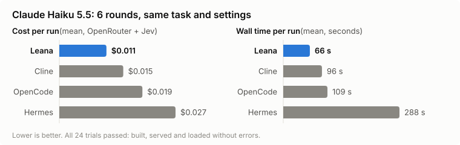
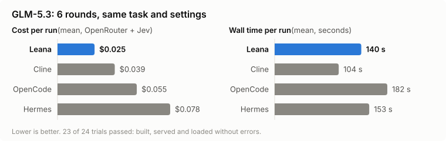
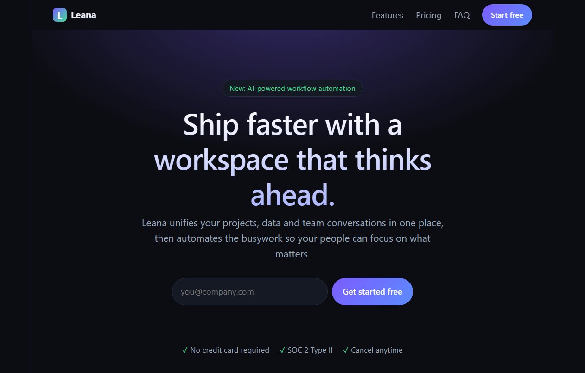
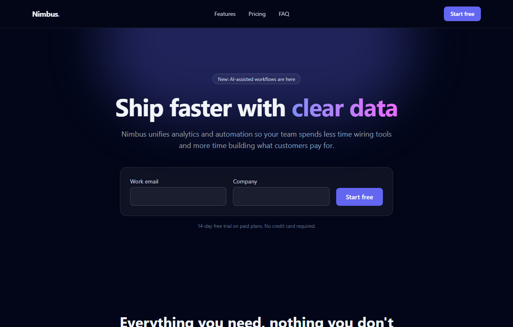
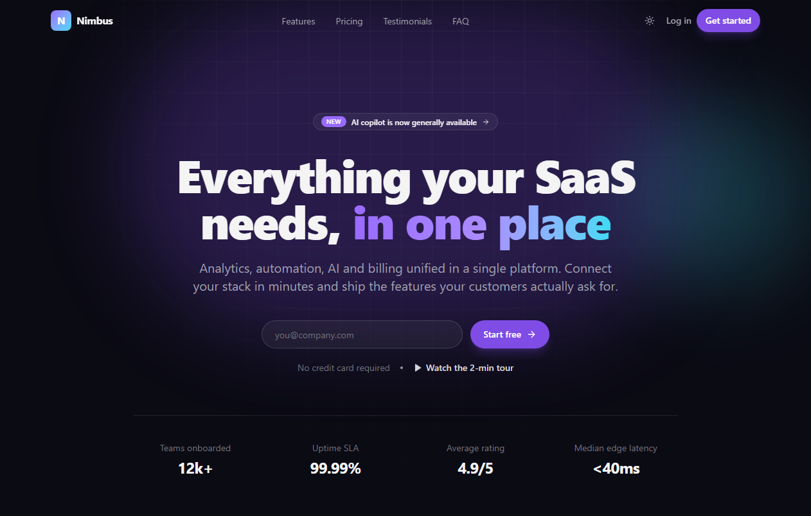
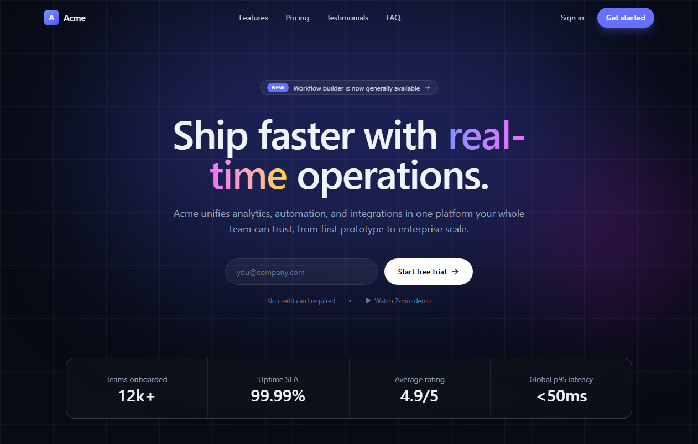

# Leana

**Fewer tokens. Lower cost. Faster work.**

Leana is an open-source coding agent. It pairs a worker model, any model on OpenRouter or a local one through llama-server, with **Jev**, a judgment model from [TypeSafe](https://typesafe.ai). The worker writes the code; Jev watches every step and decides when the work is really done, so the worker doesn't keep going after it's finished. On the same task, with the same model and settings, Leana used the fewest tokens, cost the least and finished the fastest against Cline, OpenCode and Hermes, on both models we tested.

<picture>
  <source media="(prefers-color-scheme: dark)" srcset="docs/benchmark/haiku-5.5-dark.svg">
  
</picture>

<picture>
  <source media="(prefers-color-scheme: dark)" srcset="docs/benchmark/glm-5.3-dark.svg">
  
</picture>

## The benchmark at a glance

Every harness built the same thing: _"build an advanced react demo landing page app for a saas startup using the latest and greatest best practices"_, from an empty folder. Each round ran every harness once, back to back, on the same model. Every request each harness sent carried the same reasoning effort, sampling, output cap and provider routing, and was checked for it. Cost is the OpenRouter key's usage over each trial. A trial passed if the project built, served and loaded in a headless browser with no errors.

**Claude Haiku 5.5**: 6 rounds, all 24 trials passed

| Harness   | Tokens in / out | Cost per run | Wall time | Dearest / slowest run | Quality (0–2) |
| --------- | --------------- | ------------ | --------- | --------------------- | ------------- |
| **Leana** | **68k / 10k**   | **$0.011**   | **66 s**  | $0.013 / 81 s         | 1.77          |
| Cline     | 258k / 16k      | $0.015       | 96 s      | $0.019 / 130 s        | 1.80          |
| OpenCode  | 348k / 20k      | $0.019       | 109 s     | $0.028 / 131 s        | 1.92          |
| Hermes    | 751k / 24k      | $0.027       | 288 s     | $0.036 / 604 s        | 1.93          |

**GLM-5.3**: 6 rounds, all 24 trials passed

| Harness   | Tokens in / out | Cost per run | Wall time | Dearest / slowest run | Quality (0–2) |
| --------- | --------------- | ------------ | --------- | --------------------- | ------------- |
| **Leana** | **88k / 10k**   | **$0.022**   | **88 s**  | $0.027 / 121 s        | 1.78          |
| Cline     | 373k / 17k      | $0.053       | 124 s     | $0.083 / 178 s        | 1.78          |
| OpenCode  | 321k / 25k      | $0.060       | 199 s     | $0.072 / 257 s        | 1.94          |
| Hermes    | 770k / 18k      | $0.084       | 168 s     | $0.113 / 203 s        | 1.93          |

Cost is what OpenRouter billed, plus for Leana its Jev calls, which TypeSafe bills: 3 to 5% of Leana's cost. Tokens, cost and times are means; tokens are as OpenRouter reported them, except Hermes's, which are its own report. Quality is Jev's reading of how fully each result shows what "advanced … best practices" asks for, from 0 (template-level) through 1 (complete) to 2 (showcase), given every harness's source and page check alike.

### What the results show

- **The fewest tokens.** On both models Leana read about a quarter of the input tokens of the next-leanest harness, and wrote the fewest output tokens.
- **The cheapest on both models, round by round.** Leana was cheaper than every other harness in every round on GLM-5.3, and on Claude Haiku 5.5 than OpenCode and Hermes in every round and Cline in 5 of 6. It saved $0.004 to $0.016 a run on Haiku and $0.030 to $0.062 on GLM. Each of those gaps holds at 95% confidence.
- **The fastest on both models.** Leana was faster than each of the others in at least 5 of 6 rounds on both models, by 30 to 222 seconds a run on Haiku and 36 to 111 seconds on GLM, again at 95% confidence.
- **Its costs are the most predictable.** On both models, Leana's dearest run cost less than the average run of every other harness.
- **Its lead is efficiency, not polish.** On quality, Leana is level with Cline on GLM-5.3 and just behind it on Haiku, and slightly behind OpenCode and Hermes on both, which spend more. All four land between complete and showcase; none built a template-level page.

### What they don't show

- **One task, two models, six rounds each.** A landing page is one kind of work. Long refactors, backend services and existing codebases aren't measured here.
- **Quality is read by Jev, which is also Leana's own judge.** An independent judge would be stronger evidence. So you can judge for yourself, every trial's page is in the galleries below.
- **One endpoint per model.** Every recorded request for a model went to one OpenRouter endpoint: Wafer for GLM-5.3, pinned for every harness with fallbacks off, and Google for Claude Haiku 5.5. Other endpoints run at other speeds and prices, so absolute times and costs elsewhere will differ.
- **Each harness ran with its own defaults otherwise.** Versions: Cline 3.0.73, OpenCode 2.0.32, Hermes Agent 0.21.3.

### What each harness built

One round on Claude Haiku 5.5, the round where Leana's cost was its median, not its best:

| Leana                                                                           | Cline                                                                           | OpenCode                                                                              | Hermes                                                                            |
| ------------------------------------------------------------------------------- | ------------------------------------------------------------------------------- | ------------------------------------------------------------------------------------- | --------------------------------------------------------------------------------- |
|  |  |  |  |
| $0.010 · 56 s                                                                   | $0.014 · 87 s                                                                   | $0.025 · 127 s                                                                        | $0.030 · 178 s                                                                    |

Every trial, with its cost, time and quality: the [Claude Haiku 5.5 gallery](docs/benchmark/haiku-5.5-gallery.md) and the [GLM-5.3 gallery](docs/benchmark/glm-5.3-gallery.md).

### Run it yourself

```bash
npm ci && npm run build
OPENROUTER_API_KEY=... TYPESAFE_API_KEY=... npm run bench:harnesses -- --runs 6 --scenario bench/scenario-haiku.json
```

It needs Cline, OpenCode and Hermes installed, and a dedicated OpenRouter key, since cost is measured from the key's usage. The [benchmark guide](BENCHMARK.md) covers the method, how settings are matched and checked, and what each figure means. The figures here are in [`docs/benchmark`](docs/benchmark), made from the runs' own results by `bench/readme-assets.mjs`.

## How Leana works

- **The worker reasons, then acts in batches.** Each turn it writes a few sentences of reasoning and a batch of actions: read, search, write, run a command, observe the result. Leana runs the batch and stops at the first failure.
- **Jev is the control plane.** After each batch, Jev reads whether the run is progressing, repeating a failure or stuck. It triages failed commands, and judges a finish against facts the harness gathered: the diff, the check that ran after the last edit, and what the result looked like to its user. It never decides how to implement anything.
- **The result is seen as its user meets it.** A page is loaded in a headless browser, a service is called, a program is run, and the facts go to the worker and to Jev.
- **The prompt is laid out for caching.** It's ordered by how often each part changes, so most of every request is read from the provider's cache.

The [architecture guide](docs/ARCHITECTURE.md) covers the loop, the tools, the prompt and Jev's questions in detail.

## Quick start

Leana needs Node 22+ and [ripgrep](https://github.com/BurntSushi/ripgrep). On Windows it also needs [Git for Windows](https://git-scm.com/download/win), whose bash it runs commands with.

```bash
npm install -g @grandeurintelligence/leana

export TYPESAFE_API_KEY=...     # Jev
export OPENROUTER_API_KEY=...   # the worker model

# The app: type an objective, pick a provider and model in place
leana

# Or one run from the command line
leana run "Fix the failing parser test and verify it" \
  --repo /path/to/repository --provider openrouter --model anthropic/claude-haiku-5.5 --check "npm test"
```

From source instead: `npm ci && npm run build`, then `node dist/src/cli.js` in place of `leana`.

The worker writes files and runs shell commands with your user's privileges, unsandboxed. `--no-bash` turns the shell off, and `--read-only` turns off writes too. Run it on a repository you can afford to have changed, or in a container. For a local model, start llama-server and use `--provider llama`.

## Documentation

- [Architecture](docs/ARCHITECTURE.md): the loop, tools, prompt, Jev's role, sessions and measurements
- [Benchmark guide](BENCHMARK.md): the harness comparison and the refactor benchmark, and how to reproduce them
- [Validation](VALIDATION.md): live validation runs

## Status

Leana is early. It's been measured on the landing-page task above and on the refactor and live tests in the benchmark guide, not yet across a broad range of real repositories.

## License

[Apache License 2.0](LICENSE).
