# Claude Haiku 5.5: every trial

The task: "build an advanced react demo landing page app for a saas startup using the latest and greatest best practices". 6 rounds; in each, every harness ran once with the same model and settings. Each cell is the top of the page that harness built, then its cost (OpenRouter, and Jev for Leana), wall time, Jev's quality reading (0 template-level, 1 complete, 2 showcase) and whether it passed (built, served and loaded with no errors).

| Round | Leana | Cline | OpenCode | Hermes |
| --- | --- | --- | --- | --- |
| 1 |  $0.010 · 62 s · quality 1.94 · passed |  $0.015 · 93 s · quality 1.77 · passed |  $0.025 · 141 s · quality 1.90 · passed |  $0.016 · 96 s · quality 1.95 · passed |
| 2 | 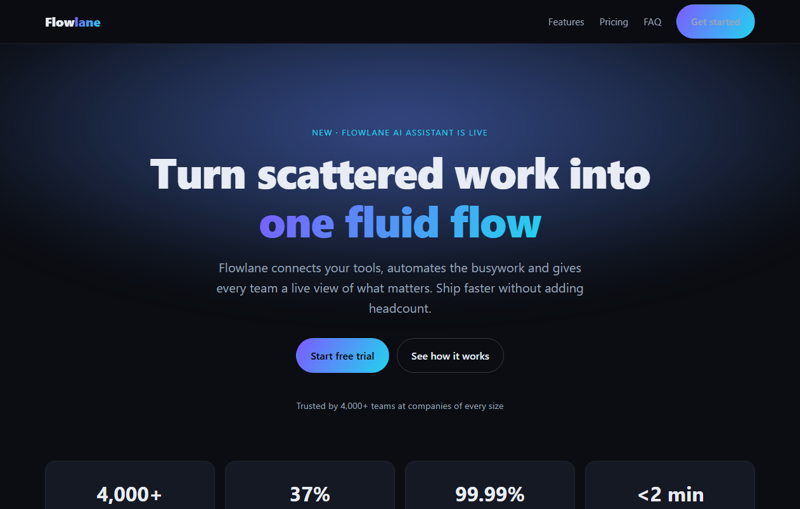 $0.010 · 60 s · quality 1.90 · passed | 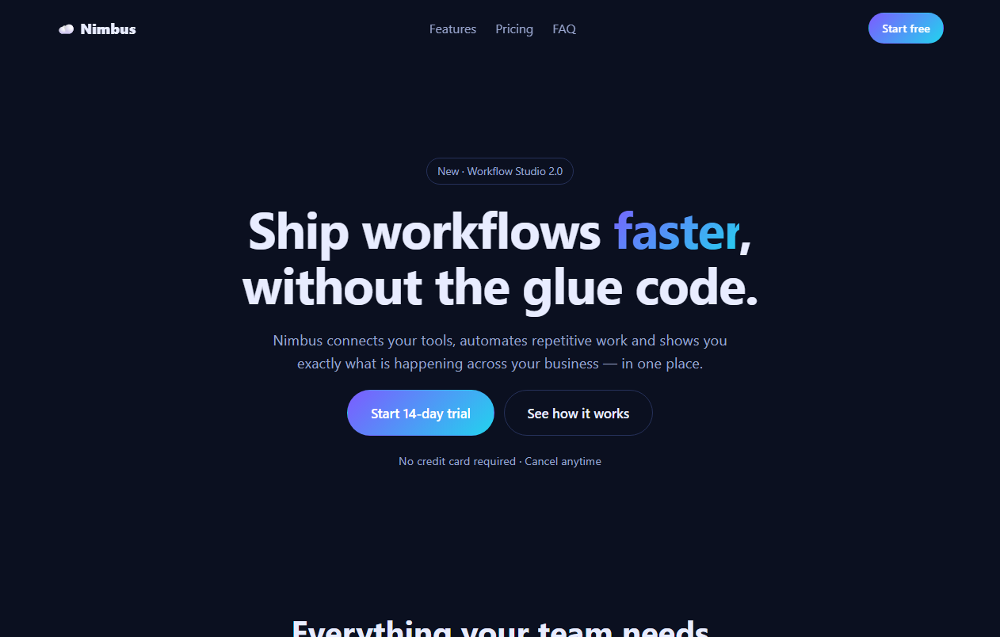 $0.017 · 100 s · quality 1.84 · passed | 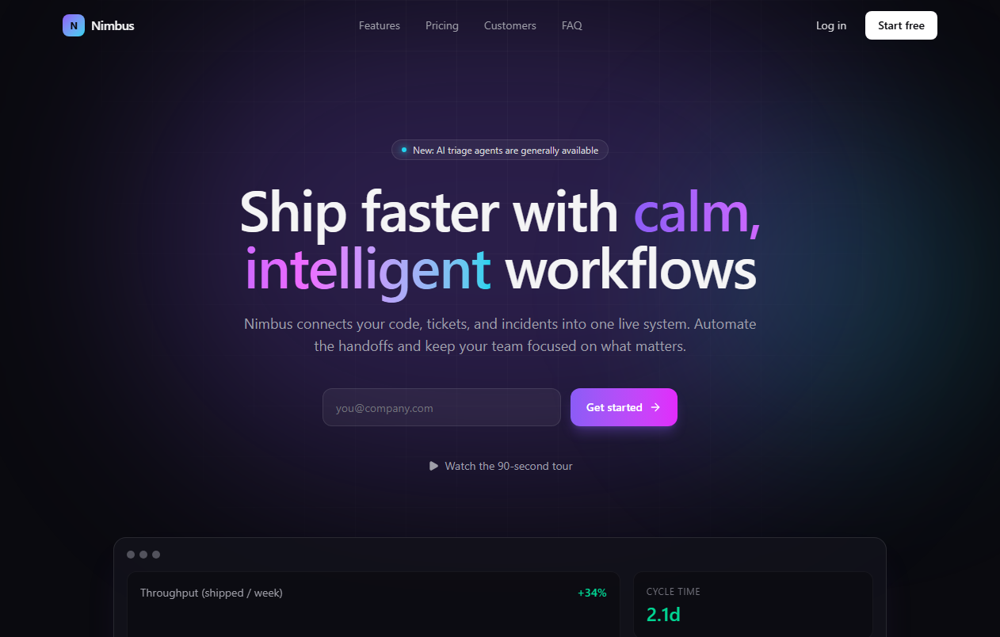 $0.013 · 99 s · quality 1.94 · passed | 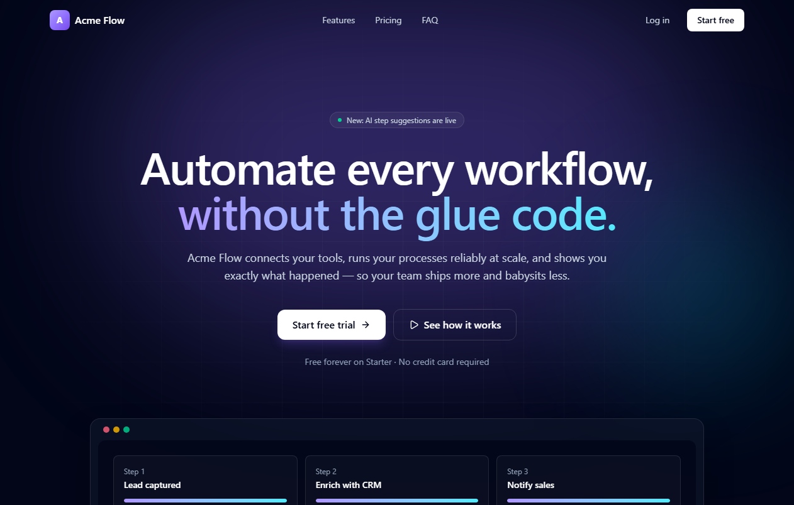 $0.019 · 111 s · quality 1.92 · passed |
| 3 |  $0.009 · 58 s · quality 1.72 · passed |  $0.017 · 94 s · quality 1.92 · passed |  $0.012 · 89 s · quality 1.93 · passed |  $0.024 · 262 s · quality 1.95 · passed |
| 4 | 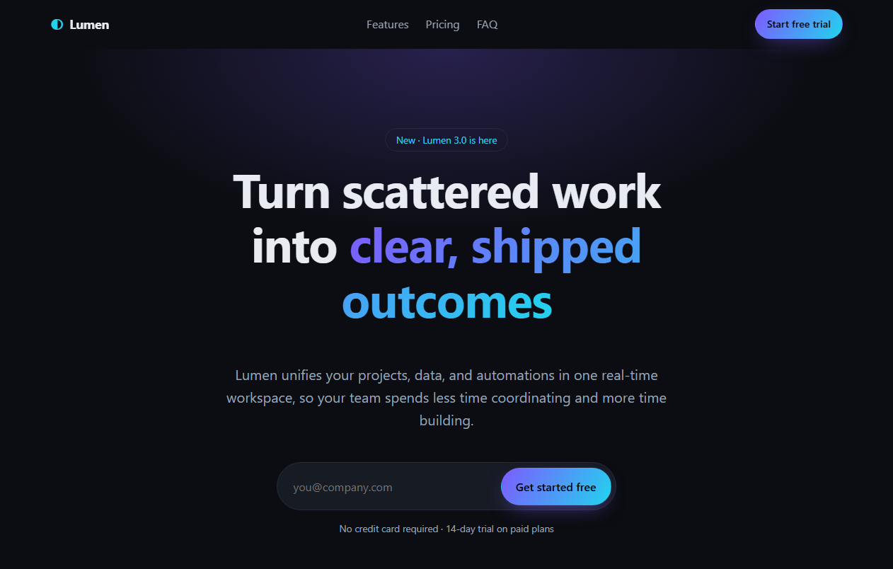 $0.017 · 85 s · quality 1.94 · passed | 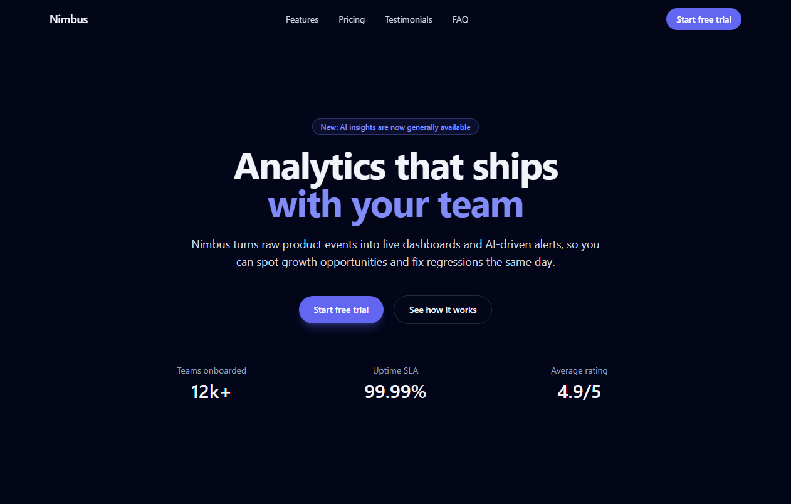 $0.015 · 80 s · quality 1.84 · passed | 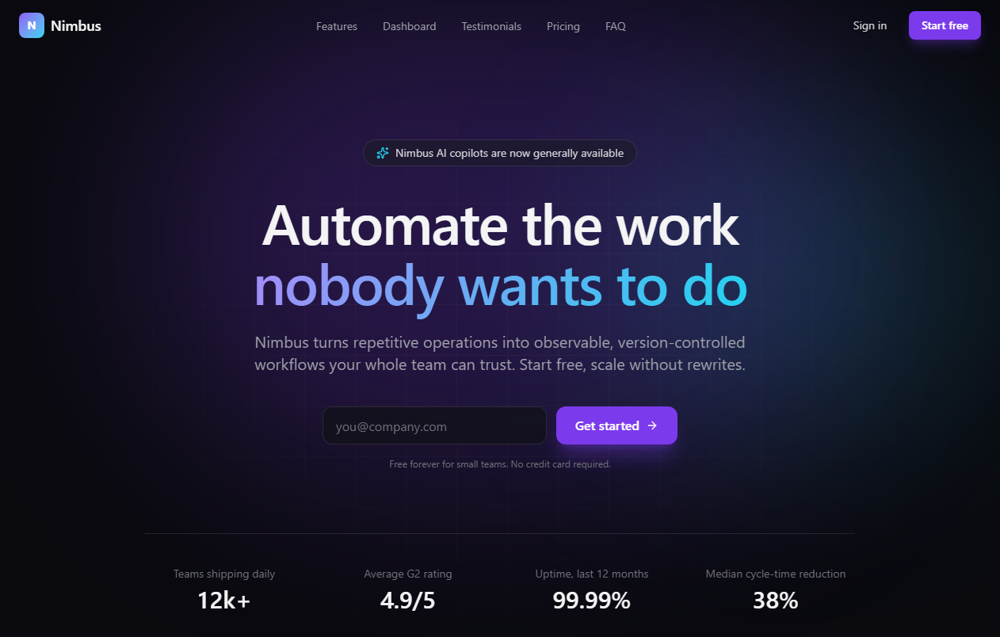 $0.024 · 207 s · quality 1.98 · passed | 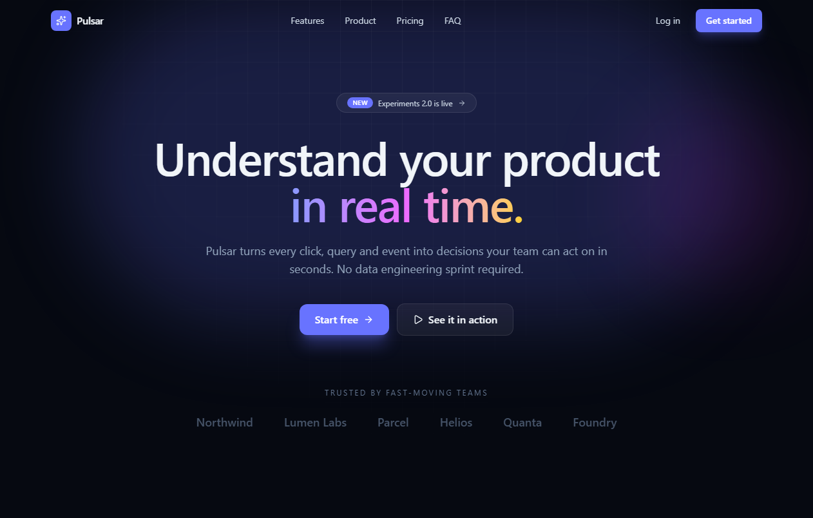 $0.030 · 453 s · quality 1.94 · passed |
| 5 | 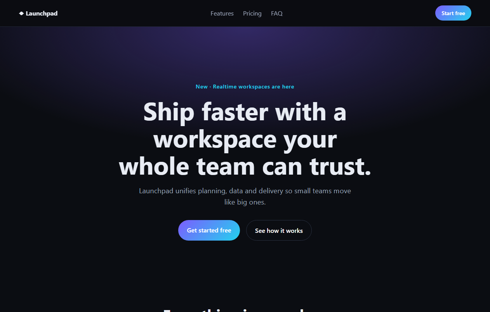 $0.011 · 58 s · quality 1.69 · passed | 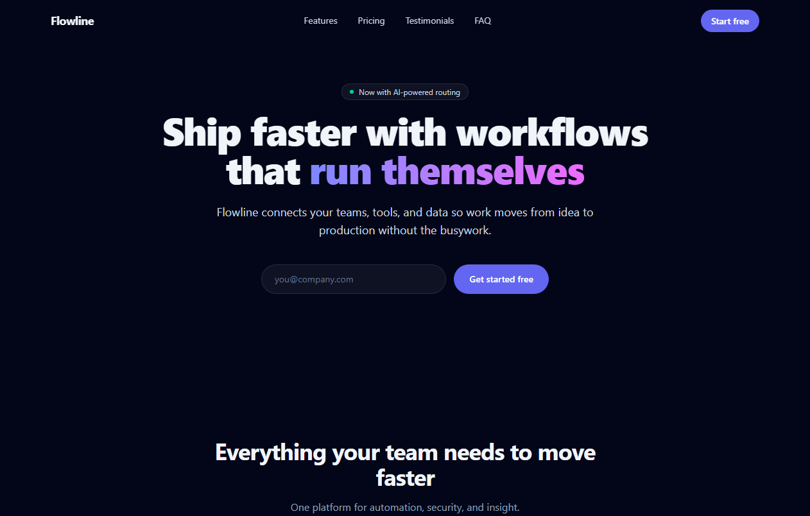 $0.020 · 115 s · quality 1.79 · passed | 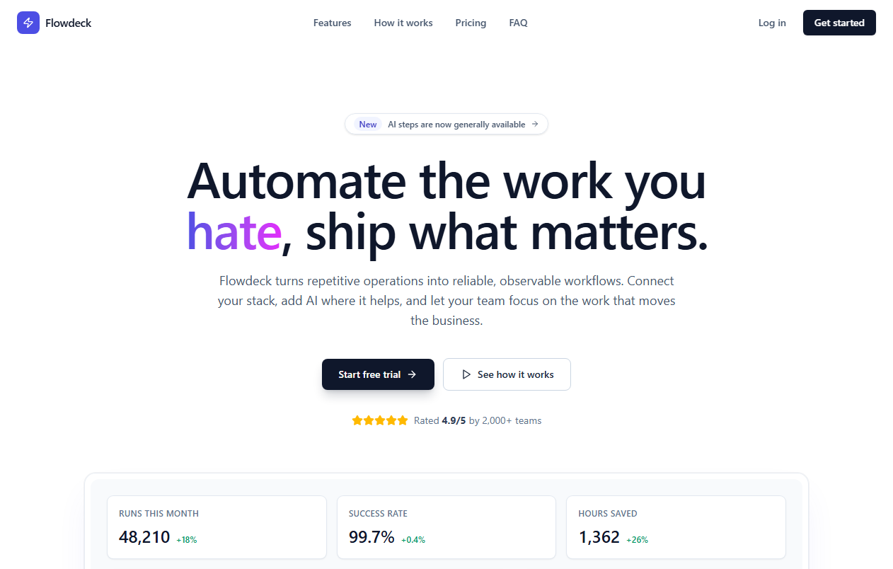 $0.024 · 118 s · quality 1.96 · passed | 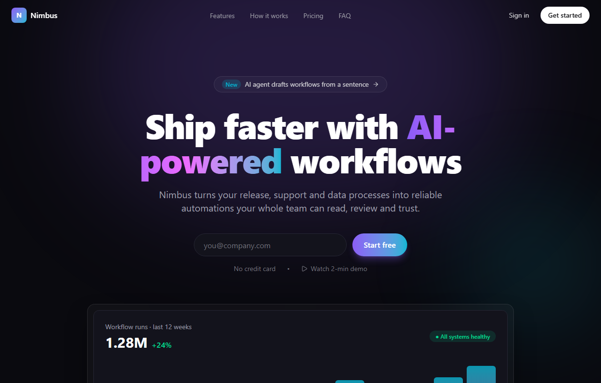 $0.031 · 433 s · quality 1.92 · passed |
| 6 | 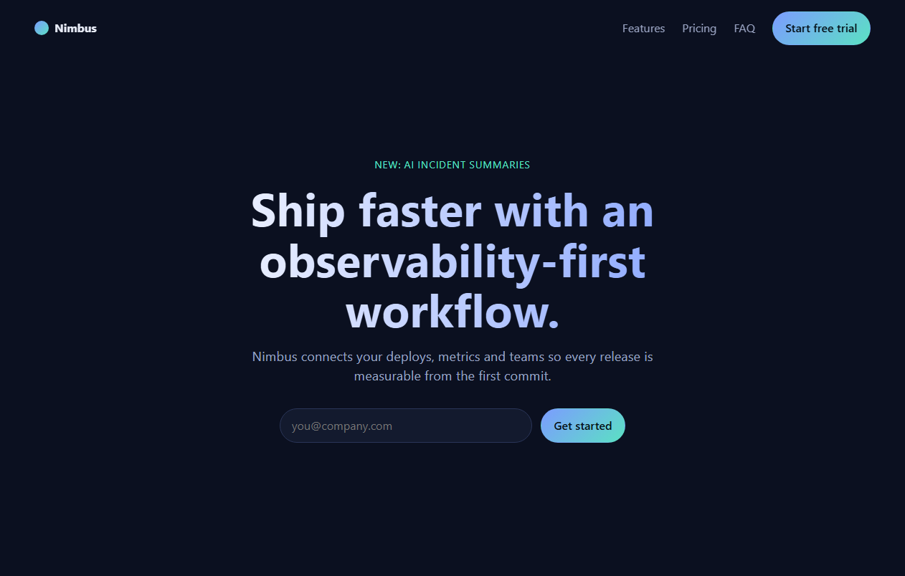 $0.013 · 73 s · quality 1.98 · passed | 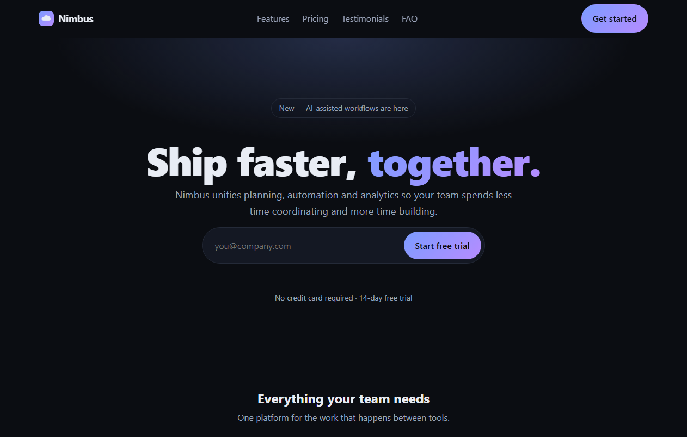 $0.027 · 158 s · quality 1.89 · passed | 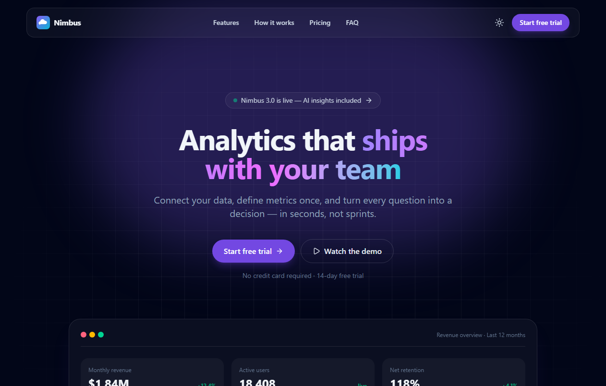 $0.030 · 205 s · quality 1.96 · passed | 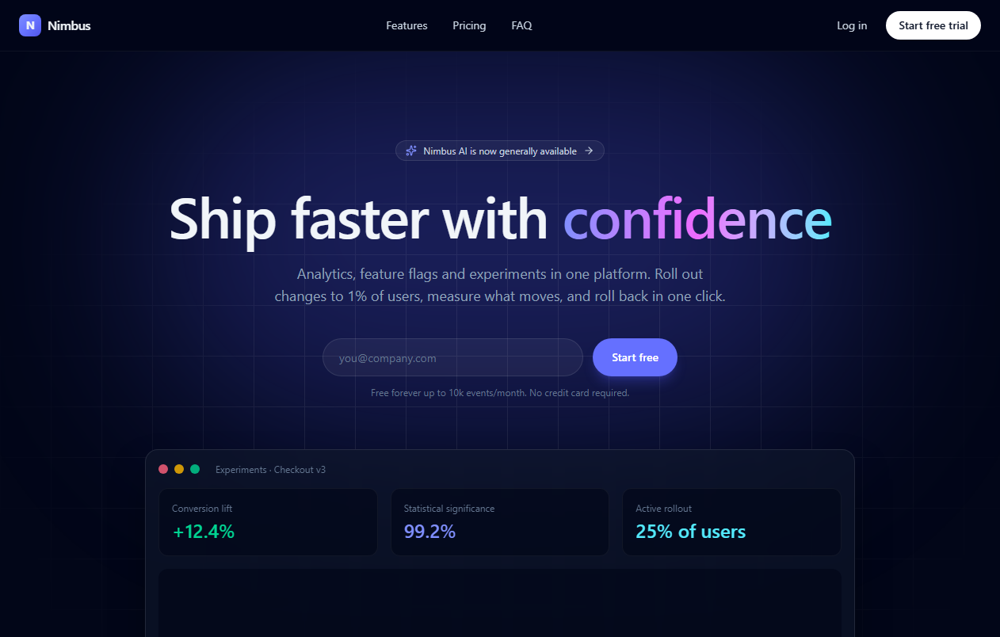 $0.021 · 366 s · quality 1.92 · passed |
